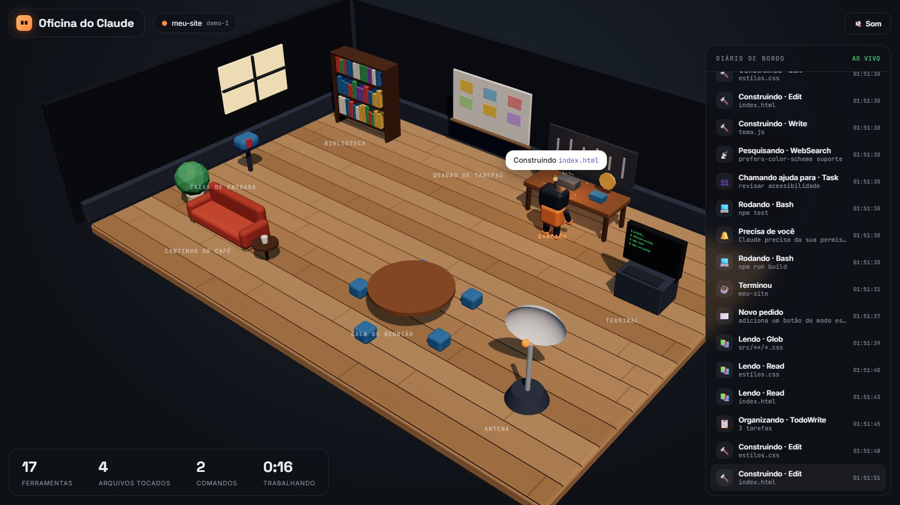
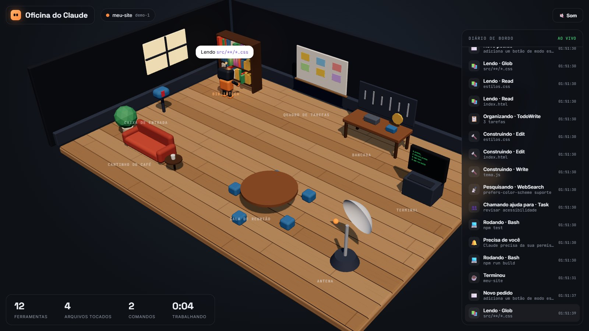
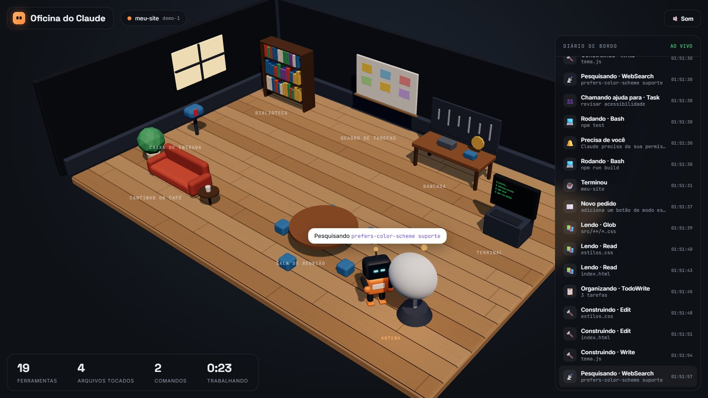
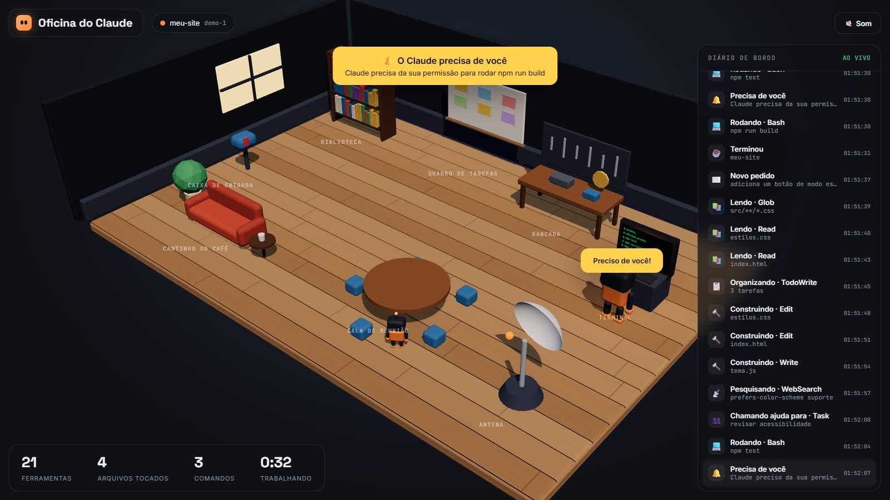

<div align="center">


<a href="https://sparks-gamesstudio.github.io/fabrica-de-canais/"></a>

**Veja o Claude Code trabalhando numa oficina 3D, ao vivo, enquanto ele mexe no seu projeto.**

<p>
  
  
  
  
</p>

<p>
  <a href="#instalacao"></a>
  <a href="https://sparks-gamesstudio.github.io/fabrica-de-canais/github.html"></a>
  
</p>



</div>

## 👋 O Rebite explica


> Sabe aquela hora em que o Claude Code está trabalhando e você fica olhando um monte de texto passar? Aqui cada ferramenta que ele usa vira uma estação de uma oficina, e um robozinho anda de uma para outra fazendo o serviço. Dá para acompanhar tudo de longe, e quando ele precisa de você, toca um sino.

<br clear="right" />

## 🛠️ O que você vê

| Quando o Claude… | O robô… |
|---|---|
| recebe um pedido seu | vai buscar a carta na **caixa de entrada** |
| lê ou procura arquivos | folheia livros na **biblioteca** |
| cria ou edita arquivos | martela na **bancada**, soltando faíscas |
| roda um comando | digita no **terminal**, que mostra o comando na tela |
| pesquisa na web | gira a **antena** |
| organiza tarefas ou planos | cola cartões no **quadro de tarefas** |
| chama um subagente | um **mini-robô ajudante** senta na sala de reunião |
| precisa da sua permissão | acena, toca um sino e mostra um alerta amarelo |
| termina | senta no **cantinho do café** e cochila |

Tem também um diário de bordo com tudo o que aconteceu, um placar (ferramentas, arquivos, comandos e tempo trabalhando), som opcional e um robô de cor diferente para cada sessão do Claude Code aberta ao mesmo tempo.

| | |
|---|---|
|  |  |
|  | |

<a id="instalacao"></a>
## ⬇️ Instalação

Precisa do [Claude Code](https://claude.com/claude-code) e do [Node.js](https://nodejs.org) 18 ou mais novo.

```bash
git clone https://github.com/sparks-gamesstudio/oficina-do-claude.git
cd oficina-do-claude
node instalar.js
node servidor.js
```

O `instalar.js` liga os hooks no seu `~/.claude/settings.json`. Ele faz backup antes e não mexe nos hooks que você já tem. O `servidor.js` abre a oficina em http://localhost:4003. Depois é só usar o Claude Code normalmente. Sessões que já estavam abertas podem precisar ser reiniciadas.

<table>
<tr>
<td width="100"></td>
<td>Só quer ver como é? Rode <code>node servidor.js --demo</code>: a oficina encena uma sessão de exemplo, sem precisar do Claude Code.</td>
</tr>
</table>

| Comando | O que faz |
|---|---|
| `node instalar.js --projeto C:\meu\projeto` | liga só para um projeto |
| `node instalar.js --remover` | desliga (aceita `--projeto` também) |
| `OFICINA_PORTA=5000 node servidor.js` | usa outra porta |

## 🔒 Privacidade

<table>
<tr>
<td width="100"></td>
<td>O hook manda para o servidor local só o tipo do evento, o nome da ferramenta e um resumo curto (nome do arquivo, primeira linha do comando, termo pesquisado). Nunca manda conteúdo de arquivo nem resposta do Claude. Tudo fica em <code>127.0.0.1</code>, e se a oficina estiver fechada o hook sai em silêncio, sem atrasar o Claude.</td>
</tr>
</table>

## 🧩 Por dentro

| Arquivo | O que faz |
|---|---|
| `hook.js` | recebe o evento do Claude Code e repassa para a oficina (Node puro, sem bash nem jq) |
| `servidor.js` | servidor local sem dependências; transmite os eventos para a página |
| `instalar.js` | liga e desliga os hooks com backup |
| `pagina/oficina.js` | a cena 3D (Three.js): estações, robôs, animações, sons e balões |

## 🙌 Créditos

Inspirado no [Vibecraft](https://github.com/Nearcyan/vibecraft) (MIT), que mostra o Claude Code em 3D no macOS e no Linux. Esta versão foi escrita do zero, roda também no Windows, não precisa de tmux nem de jq e está toda em português.

---

<div align="center">

<a href="https://sparks-gamesstudio.github.io/fabrica-de-canais/"></a>

Feito pela **[Fábrica de Canais](https://sparks-gamesstudio.github.io/fabrica-de-canais/)**, skills de Claude Code para canais de vídeo no piloto automático.

<a href="https://instagram.com/afabricadecanais"></a>
<a href="https://github.com/sparks-gamesstudio"></a>

<sub>Licença MIT · use, modifique e compartilhe. Se ajudou, deixa uma ⭐</sub>


</div>
